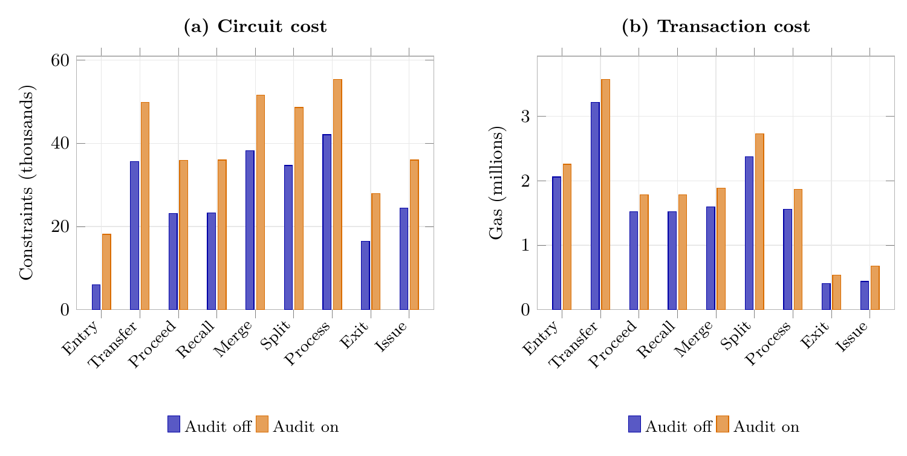
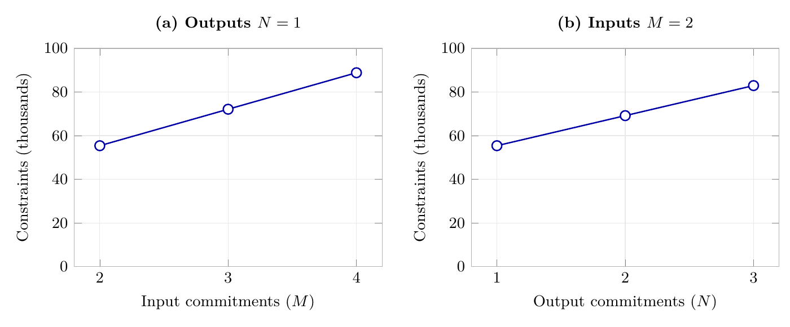
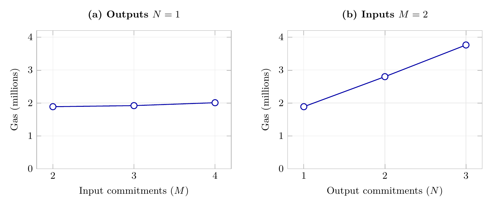

> 이전 실행 결과 문서입니다. 현재 원고의 수치는 [2026-10-16 수치표](paper-data/current-results.md)와 [재집계 안내](paper-data/README.md)를 따릅니다. 아래 표·그림은 추가 무작위화 적용 전 판본으로 보존합니다.

# zkDPP 논문용 실험 결과 초안

## 실험 환경

| 항목 | 설정 |
|---|---|
| Host PC | MacBook Pro (MacBookPro18,1) |
| Host OS | macOS 26.3 (25D125) |
| CPU | Apple M1 Pro, 10 cores (8 Performance + 2 Efficiency) |
| Host Memory | 32 GB |
| 언어 | Go 1.25.7 |
| Circuit 라이브러리 | gnark 0.15.0 / gnark-crypto 0.20.1 |
| Proof system | PLONK-KZG / BLS12-381 |
| 감사 암호화 | Jubjub / Poseidon2 |
| 병렬 실행 설정 | GOMAXPROCS=8 |
| 블록체인 노드 | Anvil 1.7.1 |
| Contract 컴파일러 | Solidity 0.8.30 |
| EVM | Prague |
| Chain ID | 31337 |
| Transaction gas limit | 30,000,000 |

## 1. 공급망 Event별 실행 비용

**실험을 진행한 이유**  
zkDPP의 Event는 공급망 동작에 더해 Proof를 검증하고 AuditRecord도 기록합니다.  
이 작업들을 모두 수행하면, Event 하나를 실행하는 데 비용과 시간이 너무 많이 드는 것은 아닐까요?

**실험 목적**  
9개 Event의 Constraints, 실제 transaction Gas, E2E를 측정합니다.  
전체 평균 대신 Event별 비용을 보여주어 동작에 따른 차이를 확인합니다.

**표·그래프 구성**  
Event 종류는 연속적인 증가 변수가 아니므로 정확한 값을 비교할 수 있는 표를 사용합니다.  
아래의 Path·Update 횟수와 Transfer 비용 분해 표는 그 차이를 설명하기 위한 근거입니다.

**고정 조건**  
State는 3개이며 AuditRecord를 기록합니다.  
Process의 입출력은 2→1입니다.

**측정 기준**  
E2E는 witness 준비부터 같은 transaction의 성공 receipt 확인까지입니다.  
Gas는 해당 transaction의 실제 gasUsed입니다.

| Event | Constraints | Gas | E2E (ms) |
|---|---:|---:|---:|
| Entry | 18,115 | 2,258,715 | 770.834 |
| Transfer | 49,883 | 3,577,414 | 1,464.369 |
| Proceed | 35,858 | 1,784,082 | 1,278.965 |
| Recall | 35,987 | 1,785,084 | 1,250.315 |
| Merge | 51,543 | 1,888,301 | 1,361.248 |
| Split | 48,608 | 2,730,046 | 1,497.729 |
| Process | 55,402 | 1,866,617 | 1,335.974 |
| Exit | 27,940 | 534,277 | 674.484 |
| Issue | 35,957 | 678,565 | 1,225.264 |

**해석**  
**Constraints**: 입력 Merkle Path 검증 + owner·객체·State 관계 검증 + Audit 암호화 검증  
**Gas**: PLONK 검증 + 출력 Tree 갱신 + 소비·생성·Audit 기록 저장

**입력 검증과 출력 등록의 횟수가 달라 Constraints와 Gas의 순위도 달라집니다.**  
입력이 늘면 Path 검증이, 출력이 늘면 Tree 갱신이 반복됩니다.  
단, 다른 검증과 저장 비용도 포함되므로 전체 비용의 정확한 비례관계를 뜻하지는 않습니다.  
Audit의 추가 비용은 2.1절에서 분석합니다.

**(a) Merkle Path Verify**

| 횟수 | Event |
|---:|---|
| 0 | Entry |
| 1 | Transfer / Proceed / Recall / Split / Exit / Issue |
| 2 | Merge / Process |

**Transfer의 Constraints 구성**

| 비용 요인 | Constraints |
|---|---:|
| Merkle Path 검증 | 9,825 |
| Encrypted AuditRecord 검증 | 14,238 |
| State·객체 관계 검증 | 17,994 |
| cm/nf·owner address 계산 | 7,826 |
| **Transfer 합계** | **49,883** |

Audit용 출력 nf·rvnf 계산은 Encrypted AuditRecord 검증에 포함합니다.

**Transfer의 Gas Cost 구성**

| 비용 요인 | Gas |
|---|---:|
| Merkle Tree Hash 계산 | 1,422,404 |
| Merkle Tree 조회·저장 | 1,276,500 |
| Proof 검증 호출 | 335,007 |
| Audit 추가 비용 | 356,146 |
| nf·cm·rv 조회·저장 | 68,700 |
| calldata 등 기타 비용 | 118,657 |
| **Transfer 합계** | **3,577,414** |

Audit 유무의 기존 대표 Gas 차이를 사용합니다. AuditRecord 저장만이 아니라 추가 검증·조회·calldata 등의 변화도 포함합니다.
Audit 없는 대표 transaction도 재실행해 항목별 차이를 확인했습니다. Audit 관련 증가분은 별도 행으로 모았으며 다른 행은 기본 실행 비용입니다.
Audit 있는 transaction의 세부 실행 분해는 `output/paper-supplement/transfer-gas-attribution/`에 보존합니다.

**(b) Merkle Tree Update**

| 횟수 | Event |
|---:|---|
| 0 | Exit / Issue |
| 1 | Entry / Proceed / Recall / Merge / Process |
| 2 | Transfer / Split |

Process는 기본 2→1 구성입니다.  
Tree 갱신은 Note·Voucher 등록을 셉니다.

## 2. Audit 추가 비용과 Auditor 수행 비용

**실험을 진행한 이유**  
Traceability를 제공하려면 Participant가 정보를 암호화해 남기고 Auditor가 이를 복원해야 합니다.  
기록을 남기는 비용뿐 아니라 이후 추적·Freeze하는 부담까지 커지는 것은 아닐까요?

**실험 목적**  
Participant가 정보를 암호화해 기록하는 비용과 Auditor가 추적·동결하는 비용을 나눕니다.

**표·그래프 구성**  
기록 비용은 Audit 유무로 비교하고, Tracing과 Freeze는 처리 대상 수에 따른 변화를 보여줍니다.

### 2.1 Event별 Audit 추가 비용

**실험을 진행한 이유**  
zkDPP의 Event는 Auditing에 필요한 정보를 암호화해 기록합니다.  
Audit이 없는 같은 Event보다 Constraints와 Gas가 크게 증가하는 것은 아닐까요?

**표·그래프 구성**  
입력·State·권한·Tree 조건을 맞춘 Audit X/O 막대를 Event별로 나란히 배치합니다.  
Constraints와 Gas는 단위가 다르므로 그래프를 분리하고, 표에는 각각의 증가량을 표시합니다.

**고정 조건**  
각 Event의 입력·출력 State와 시작 Tree를 맞춥니다.  
owner·membership·소비 방지·Status·Policy 검사는 유지합니다.  
**변경 조건**  
Audit 암호화·기록·Tracing mapping을 추가한 경우와 추가하지 않은 경우를 비교합니다.

**그림 1. 동일 Event의 Audit 없음·있음 비교. 왼쪽은 Constraints, 오른쪽은 실제 transaction Gas입니다.**

**해석**

**Constraints 증가량은 약 1.1만–1.4만 개로, Event별로 비슷합니다.**  
Encrypted AuditRecord 검증에 필요한 R·Z의 scalar multiplication 두 번이 큰 공통 비용을 만듭니다.  
암호화할 Field 수와 출력 nf·rvnf 계산에 따라 나머지 증가량이 달라집니다.

**Gas 증가량은 약 13만–36만이며, Traceability 정보를 기록하는 SSTORE 비용이 크게 반영됩니다.**  
Contract는 Event가 만든 cm·rv·h마다 해당 Event의 AuditRecord ID를 기록합니다.  
따라서 출력 cm·rv·h와 AuditRecord에 담는 암호화 값이 많아질수록 SSTORE 횟수도 증가합니다.

**Transfer의 Audit 추가 Constraints**

| 비용 요인 | Constraints |
|---|---:|
| R·Z scalar multiplication | 8,611 |
| 키·mask 계산 | 2,399 |
| 난수·암호문 등 검증 | 1,723 |
| 출력 nf·rvnf 계산 | 1,505 |
| **합계** | **14,238** |

**Transfer의 Audit 추가 Gas**

| 비용 요인 | Gas |
|---|---:|
| AuditRecord SSTORE | 324,100 |
| Proof 검증 호출 증가분 | 4,585 |
| SLOAD·calldata 등 기타 증가분 | 27,461 |
| **합계** | **356,146** |

### 2.2 Tracing·Freeze 비용

**실험을 진행한 이유**  
Tracing은 연결된 AuditRecord를 조회하고 복호화해야 합니다.  
공급망이 길어져 방문할 기록이 많아지면, 추적에 너무 오래 걸리는 것은 아닐까요?  
Freeze도 대상마다 transaction을 실행하므로, 동결 대상이 많아지면 시간과 Gas 부담이 커지는 것은 아닐까요?

**표·그래프 구성**  
Tracing과 Freeze를 병렬로 배치하고 같은 시간 단위와 로그축 범위로 비교합니다.  
이 Split 시나리오에서는 방문 AuditRecord 수와 Freeze 대상 수가 각각 10·100·1,000개입니다.

**측정 범위**  
Tracing은 기록 조회·복호화·연결 탐색 시간입니다.  
Freeze는 제출 전 상태 검사부터 개별 동결 transaction·최종 상태 확인까지입니다.  
세 시간은 별도로 측정했으며 합산한 AuditAndFreeze E2E가 아닙니다.

**Tracing**

| Visited AuditRecords | Forward (s) | Backward (s) |
|---:|---:|---:|
| 10 | 0.067 | 0.068 |
| 100 | 0.681 | 0.554 |
| 1,000 | 9.760 | 8.102 |

**Freeze**

| Freeze targets | Time (s) |
|---:|---:|
| 10 | 0.220 |
| 100 | 2.448 |
| 1,000 | 60.540 |

Note 한 개를 Active에서 Frozen으로 변경하는 비용은 **49,434 Gas**입니다.

## 3. zkTransfer와 Voucher 전달 Tradeoff 비용
**실험을 진행한 이유**  
zkTransfer는 한 번에 Receiver Note를 만들지만, Voucher 전달은 Transfer와 Proceed 두 단계가 필요합니다.  
Proof와 transaction이 하나씩 늘어나면 Gas 부담도 커지는 것은 아닐까요?  
SharedSecret zkTransfer로도 Traceability를 제공할 수 있는데, 왜 Voucher 단계가 필요할까요?

**SharedSecret zkTransfer란?**  
기존 zkTransfer는 owner secret sk를 사용해 nf를 계산합니다.  
SharedSecret zkTransfer는 이를 Note opening에서 유도한 shared secret으로 계산하도록 변경한 비교군입니다.  
Sender와 Receiver가 opening을 공유하므로, Sender도 Receiver Note의 nf를 계산할 수 있습니다.  
단, 소비 권한은 owner secret으로 별도 검증하므로 opening만 아는 Sender가 Receiver Note를 소비할 수는 없습니다.

**Tradeoff로 얻는 장점**

**1. Receiver 수령 전 Sender의 Recall**  
Receiver가 Proceed하기 전에는 Sender가 허용된 기한 안에서 Recall할 수 있습니다.  
Proceed와 Recall은 같은 rvnf를 소비하므로 둘 중 하나만 성공합니다.

**2. Sender에게는 후속 소비를 숨기고, Auditor에게는 추적을 허용**  
SharedSecret zkTransfer에서는 Sender도 Receiver Note의 nf를 계산해 후속 소비를 식별할 수 있습니다.  
Voucher 방식에서는 Receiver Note의 nf를 Receiver secret으로 계산합니다.  
Sender는 Proceed까지 연결할 수 있고, Auditor는 암호화된 nf를 복원해 그 이후 소비도 추적합니다.

**비교 조건**  
**zkTransfer:** Audit 없는 직접 전달입니다.  
**SharedSecret zkTransfer:** Audit을 지원하지만 Sender도 후속 소비를 식별할 수 있는 직접 전달입니다.  
**RecallVoucher:** Audit을 포함한 Transfer → Recall 경로의 합계입니다.

표는 세 방식의 기능과 Gas를 비교합니다.  
Recall 경로는 정상 수령 경로와 결과가 다르며, Audit 조건도 달라 Voucher만의 순수 추가 비용은 아닙니다.

| 전달 방식 | Traceability | Privacy | Recall | 총 Gas |
|---|---|---|---|---:|
| zkTransfer¹ | X | O | X | 2,366,228 |
| zkTransfer² | O | △ | X | 2,724,242 |
| RecallVoucher | O | O | O | 5,362,498 |

Privacy △: Sender가 Receiver Note의 후속 소비를 식별할 수 있습니다.  
¹ owner secret 기반 nf를 사용하는 Audit 없는 직접 전달입니다.  
² shared secret 기반 nf와 Audit을 사용하는 직접 전달이며, Gas는 공식 1회 측정값입니다.

## 4. Process 입출력 cm 수에 따른 비용

**실험을 진행한 이유**  
공정에 따라 여러 원료를 투입하거나 제품·부산물을 여러 종류로 생산해야 합니다.  
이처럼 입력·출력 Note 수가 늘어나면, Process의 검증과 온체인 실행 비용이 크게 증가하는 것은 아닐까요?

**실험 목적·범위**  
공정의 입력·출력 개수에 따른 Constraints와 Gas의 변화 경향을 확인합니다.  
모든 산업별 공정을 구현하는 대신, 기존 POC의 Sustainability State 검증·변환·할당 규칙으로 범위를 제한합니다.

**통제 조건**  
입출력 개수의 영향을 분리하기 위해 입력 State 합계 (320,30,231), 출력 합계 (300,30,261)과 공정 규칙을 고정합니다.  
Audit을 포함하며, 출력 N=1에서 입력 M을 늘리고 입력 M=2에서 출력 N을 늘립니다.

**표·그래프 구성**  
입력 증가와 출력 증가의 영향을 구분하기 위해 두 묶음의 그래프를 사용합니다.  
각 그래프의 왼쪽 축은 Constraints, 오른쪽 축은 Gas이며 색으로 구분합니다.  
두 그래프의 축 범위는 같게 유지하고, 아래 표에 정확한 수치를 제공합니다.

**고정 조건**  
State는 3개이며 입력 합계는 (320,30,231), 출력 합계는 (300,30,261)입니다.  
질량 손실률 6.25%, 탄소 추가 30, WASTE 생성률 0%를 유지합니다.

**입력 수 증가**  
출력은 1개로 고정하고 입력을 2·3·4개로 늘립니다.

**출력 수 증가**  
입력은 2개로 고정하고 출력을 1·2·3개로 늘립니다.

**측정 조건**  
입출력 허용 범위를 확장한 보충 원장에서 각 조건을 공식 1회 측정했습니다.  
Audit 없음·있음은 같은 State·root·Policy 조건으로 비교합니다.

**그림 4. 입력 수와 출력 수 증가에 따른 Constraints.**

**그림 5. 입력 수와 출력 수 증가에 따른 실제 Gas.**

## 5. k-of-n Master Key 복구 비용

**실험을 진행한 이유**  
Auditor는 Committee로부터 전달받은 k개의 share로 Master Key를 복구합니다.  
사용하는 share k가 많아지면 복구 시간이 크게 늘어나는 것은 아닐까요?

**측정 범위**  
Committee의 공개키와 위원별 public share는 사전에 검증해 보관합니다.  
받은 k개 share의 검증, Lagrange 보간, 복구한 키의 공개키 일치 확인을 측정합니다.  
전체 Committee 정보의 사전 검증, 키 생성·DKG·통신·승인 대기는 제외합니다.

**비교 조건**  
Committee n=10을 고정하고 share k를 2·3·5·7·10개로 늘립니다.  
각 case는 warm-up 후 공식 1회 측정하며, 내부 1,000회 복구의 평균 시간을 표시합니다.

**해석**  
k가 늘면 검증할 share 수와 Lagrange 보간의 연산량이 증가합니다.  
복구식은 선택한 k개 share와 위원 ID를 사용하며, 전체 위원 수 n은 직접 포함하지 않습니다.

$
SK=\sum_{i\in Q}\lambda_i s_i \pmod q,\qquad
\lambda_i=\prod_{\substack{j\in Q\\j\ne i}}\frac{-x_j}{x_i-x_j}\pmod q,\qquad |Q|=k.
$
$Q$는 선택한 위원 집합, $s_i$는 share, $x_i$는 위원 ID이며 나눗셈은 modulo $q$의 역원 연산입니다.  
$n$은 전체 위원 수와 $k\le n$ 조건을 정하지만, 고정된 $Q$의 복구 연산량을 늘리지 않습니다.

| share k | 복구 시간 (ms) |
|---:|---:|
| 2 | 0.188 |
| 3 | 0.251 |
| 5 | 0.384 |
| 7 | 0.520 |
| 10 | 0.737 |

n 증가 실험은 본문에서 제외하고 원자료에 보존합니다.

## 재현성과 범위

기존 원자료는 output/experiments의 실험 1·2·3·4·8입니다.  
Process 보충 원자료는 output/paper-supplement/process-independent.json입니다.  
집계 CSV와 원자료 SHA-256은 docs/paper-data에 저장했습니다.  
Process 보충 실험은 각 조건 1회입니다.  
다른 항목의 기존 5회 median과 통계를 합치지 않습니다.  
Anvil 관측으로 Production finality·동시 처리량·Privacy 보안을 입증하지 않습니다.
